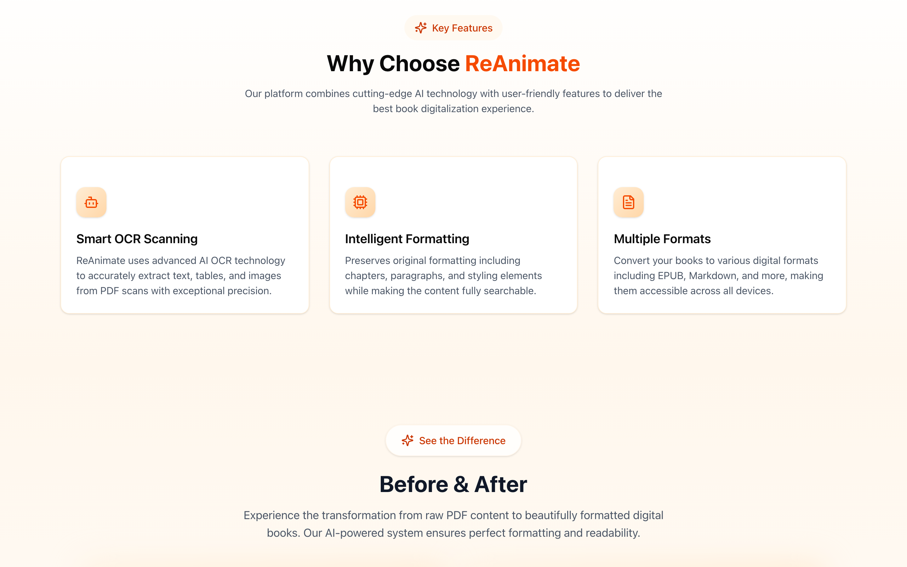
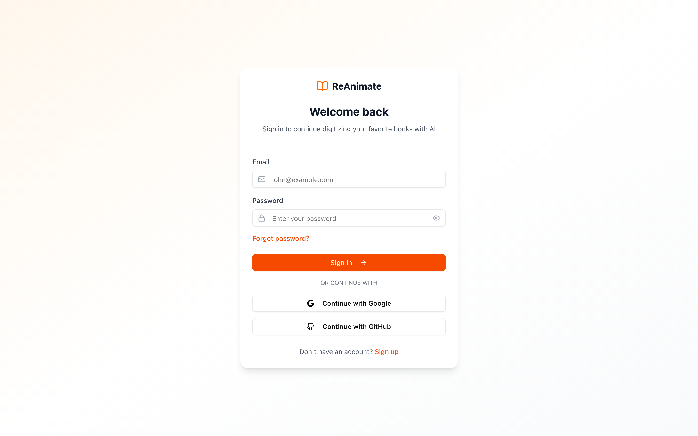

# ReAnimate

Turn scanned book PDFs into EPUB and Markdown. AI OCR reads the pages, then a conversion worker rebuilds the layout so the result stays readable and searchable.


## What you can do

- Convert a PDF to **EPUB** or **Markdown**
- Pull notes, images, and tables out of study materials
- Sign in with email, Google, or GitHub and follow each conversion job





## How it fits together

The Next.js app handles accounts, uploads, and job status. Conversions run in the Rust server next to this repo (`../converter_server`, Axum on port 8000): it OCRs pages, fills in book metadata, and writes the file with Pandoc. Postgres stores users and jobs.

## Run it

```bash
npm install
npx prisma migrate dev
npm run dev
```

Open [http://localhost:3000](http://localhost:3000).

Set these in `.env`: `DATABASE_URL`, `DIRECT_URL`, `AUTH_SECRET`, and `NEXT_PUBLIC_APP_URL`. Google and GitHub sign-in also need `GOOGLE_CLIENT_ID`, `GOOGLE_CLIENT_SECRET`, `GITHUB_CLIENT_ID`, and `GITHUB_CLIENT_SECRET`. Password-reset email uses `RESEND_API_KEY`.

Start the converter beside the app:

```bash
cd ../converter_server
cargo run
```

It reads `DIRECT_URL`, `MISTRAL_API_KEY`, and `GROK_API_KEY`. The app calls it at `RUST_SERVER_URL` (default `http://localhost:8000`).
